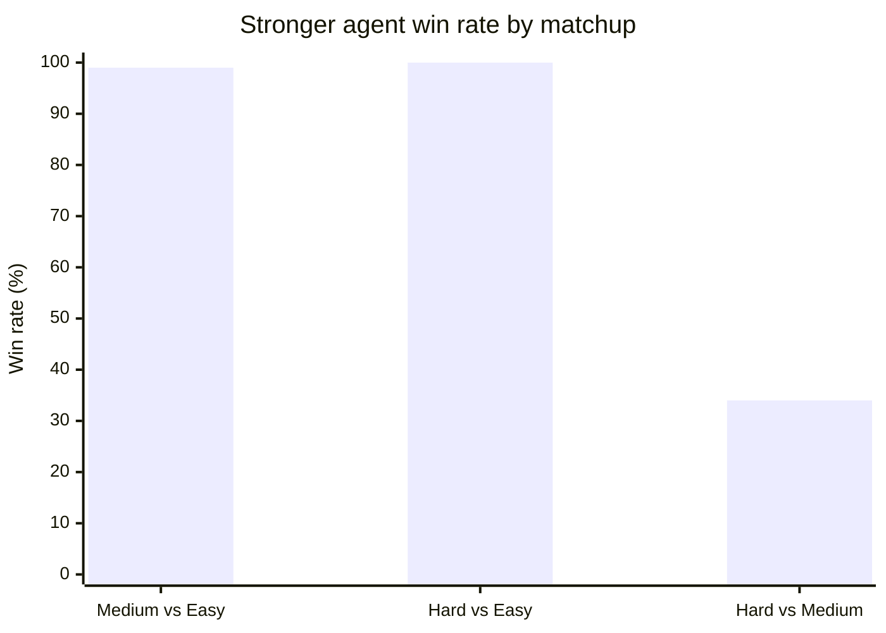
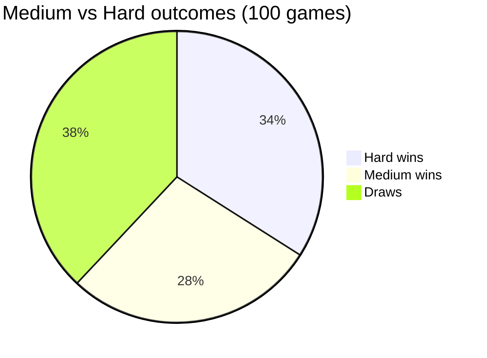
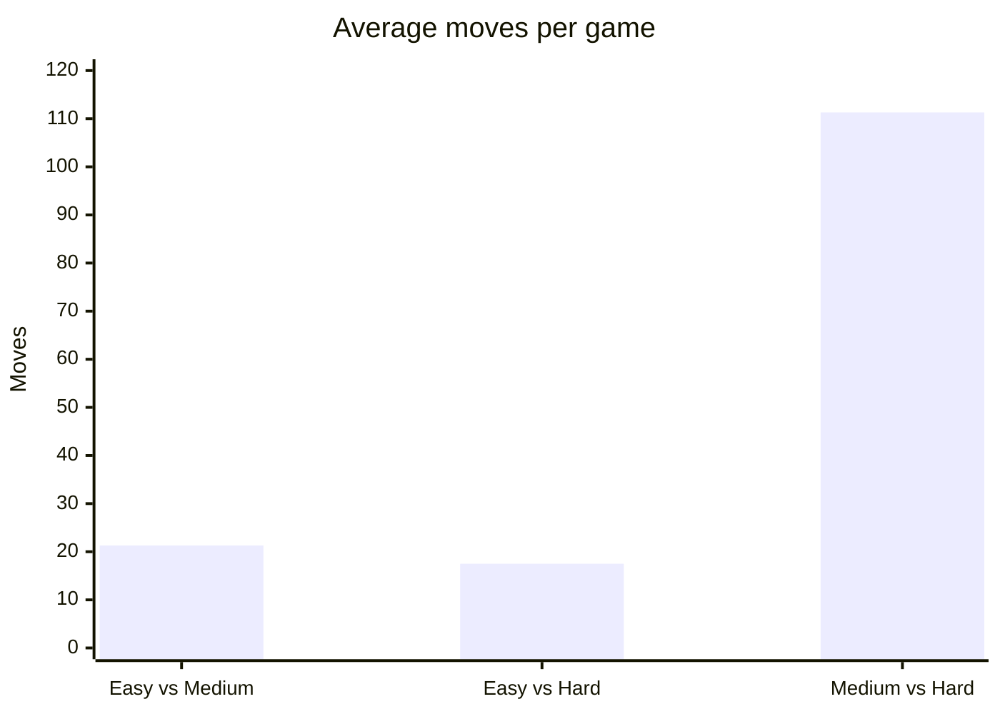
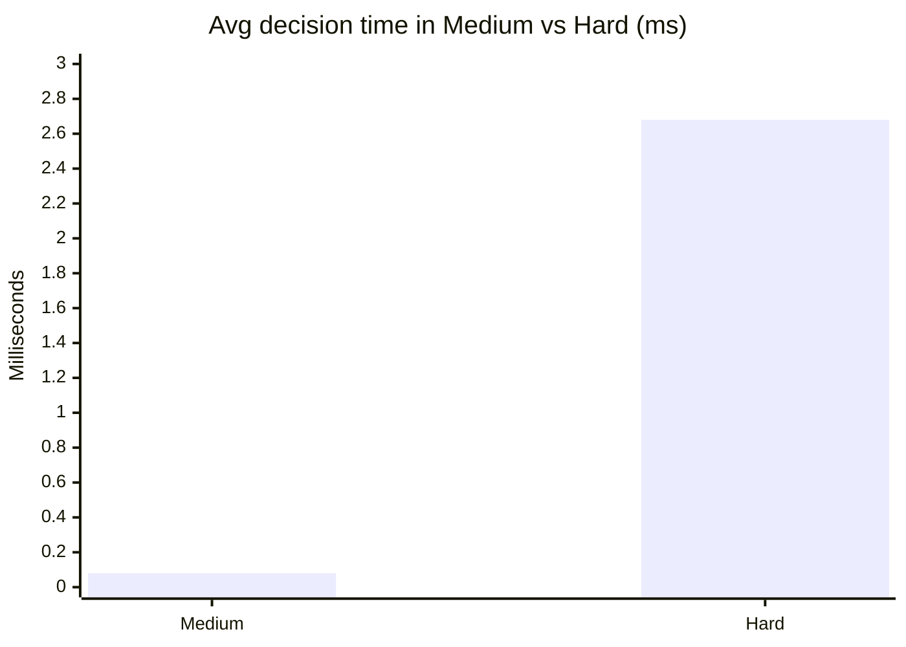
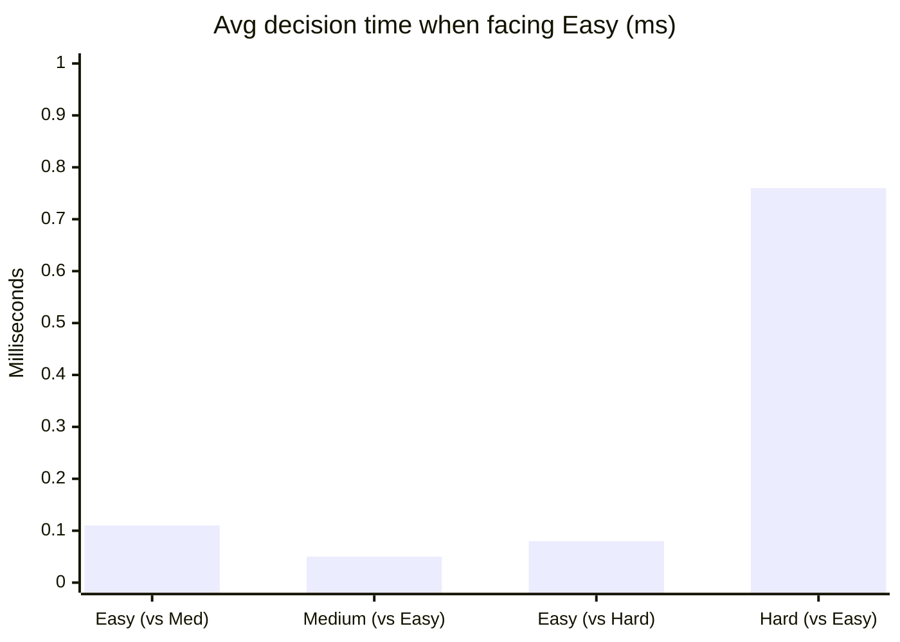
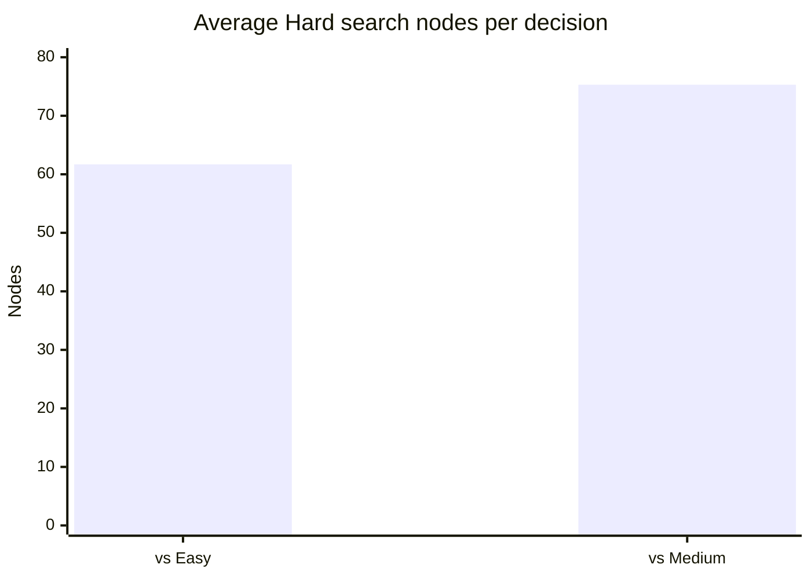
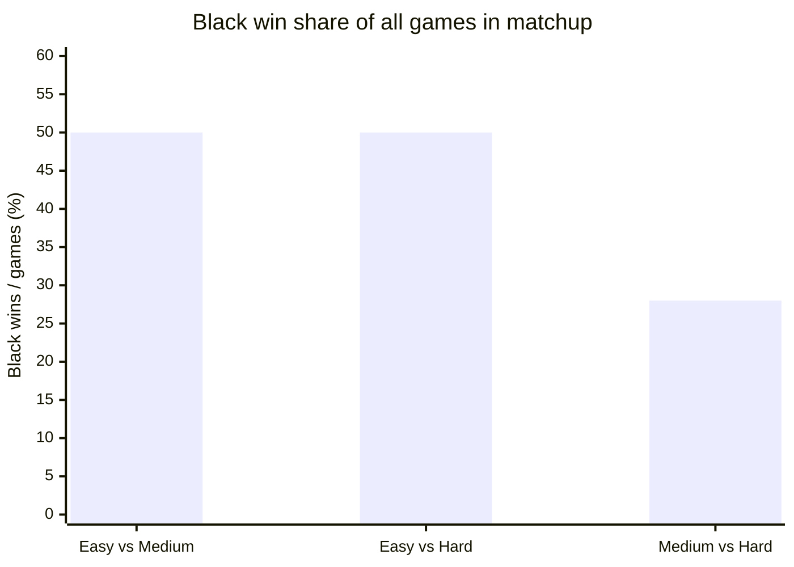

# Gomoku (Five in a Row)

A browser-based Gomoku game built as an AI Engineering learning project with Cursor Agent. Play locally against another person, against three built-in AI difficulty levels, or watch AI vs AI. A separate **local-only** Node.js harness benchmarks the AIs. No frameworks, bundlers, external AI APIs, or server backends are required.

Portfolio index: [ai-agent-learning](https://github.com/mason-su/ai-agent-learning)

## Live Demo

- **Play online:** [https://mason-su.github.io/ai-gomoku/](https://mason-su.github.io/ai-gomoku/)
- **Status:** Deployed and verified

## Features

- Responsive 15×15 Gomoku board (desktop and mobile)
- Stones placed on **grid intersections**, not inside squares
- Freestyle rules: five or more consecutive stones wins; no forbidden moves
- Player vs Player mode
- Player vs AI with Easy / Medium / Hard difficulties
- In vs-AI games, choose to play **Black (first)** or **White (second)**
- **AI vs AI spectator mode** (all 9 difficulty pairs) with Start / Pause / Resume / Restart and speed control
- Winning-line highlight, last-move marker, and live turn status
- Restart Game and Reset Scores controls
- Invalid-move prevention and UI lock during AI / spectator turns
- Automated Node tests for rules, AI validity, and the benchmark harness
- Local developer benchmark under `experiments/` (not exposed on GitHub Pages)
- GitHub Pages compatible (relative asset paths, no build step)

## Technologies

- HTML5 / CSS3 / Vanilla JavaScript
- Modular IIFE scripts shared by the browser and Node tools
- Heuristic evaluation + Minimax with Alpha-Beta pruning (Hard AI)

---

## Project Structure

```text
ai-gomoku/
├── index.html           # Public web UI (GitHub Pages entry)
├── styles.css
├── script.js            # UI / PvP / vs-AI / spectator orchestration
├── js/
│   ├── game.js          # Pure rules
│   └── ai.js            # Easy / Medium / Hard (+ sync chooser for benchmarks)
├── test-logic.js        # Browser-facing rules & AI unit tests
├── experiments/         # LOCAL ONLY — not linked from the web UI
│   ├── README.md
│   ├── run-benchmark.js
│   ├── test-benchmark.js
│   ├── lib/             # simulate, stats, report, seed
│   └── results/         # CSV / JSON / Markdown outputs + checkpoint
└── README.md
```

| Path | Responsibility |
|------|----------------|
| `index.html` / `styles.css` / `script.js` | Public site served by GitHub Pages |
| `js/game.js` | Freestyle rules (shared by UI + experiments) |
| `js/ai.js` | AI policies (shared by UI + experiments) |
| `experiments/` | Headless matchups, checkpoints, reports |

Load order in the browser:

```html
<script src="./js/game.js"></script>
<script src="./js/ai.js"></script>
<script src="./script.js"></script>
```

---

## Game Rules (Freestyle Gomoku)

1. Black and White alternate on empty intersections of a 15×15 grid.
2. Black always opens the game (in vs-AI mode you may sit Black or White).
3. The first player to form an unbroken line of **five or more** stones — horizontally, vertically, or diagonally — wins.
4. There are **no** renju-style forbidden moves.
5. If every intersection is filled with no winner, the game is a draw.

---

## AI Architecture

All AI runs **locally**. Nothing is sent to an API.

| Level | Strategy | Typical use |
|-------|----------|-------------|
| **Easy** | Forced win/block, then noisy weighted/uniform picks among top candidates | Beginner |
| **Medium** | Greedy heuristic: attack + defence | Solid local play |
| **Hard** | Depth-limited Minimax + Alpha-Beta + heuristics + candidate filter | Shallow search demo |

See earlier sections in git history / code comments for pattern scores, candidate generation (Chebyshev radius 2), and Easy’s `EASY_DEFAULTS`.

`chooseMoveSync` in `js/ai.js` exposes the same policies synchronously for Node benchmarks (Hard search is shared with the browser via `searchHardMove`).

---

## Public: AI vs AI spectator mode

Available in the Mode dropdown as **AI vs AI (Spectate)** on the GitHub Pages site.

1. Independently choose Easy / Medium / Hard for **Black AI** and **White AI** (9 combinations).
2. Set playback **Speed**.
3. **Start** — both AIs move automatically in turn.
4. **Pause** / **Resume** — freeze or continue; pending async moves are cancelled safely via a generation token.
5. **Restart** — clear the board and stop autoplay (press Start again).
6. The board is **view-only** in this mode (no manual stone placement).
7. Switching away from spectator mode cancels pending AI work and restores PvP / vs-AI controls.

Scores, last-move marker, win highlight, and status text remain visible.

---

## Developer-only: AI benchmarking

**Not part of the public website.** Run locally with Node.js.

### Command (full 300 games)

```bash
node experiments/run-benchmark.js --all --seed 42
```

### Recommended first check (small sample)

```bash
node experiments/run-benchmark.js --smoke --seed 42
```

### Other useful flags

```bash
node experiments/run-benchmark.js --resume
node experiments/run-benchmark.js --all --seed 42 --hard-depth 2
node experiments/test-benchmark.js
```

### Design

| Matchup | Games | Colour balance |
|---------|-------|----------------|
| Easy vs Medium | 100 | 50 / 50 as Black |
| Easy vs Hard | 100 | 50 / 50 as Black |
| Medium vs Hard | 100 | 50 / 50 as Black |

- Reuses `js/game.js` + `js/ai.js` (no fork of the engines).
- Headless (no DOM).
- Records wins / losses / draws, win rates (overall and by colour), average moves, average decision time, Hard node counts.
- Checkpointing to `experiments/results/checkpoint.json` for `--resume`.
- Optional `--seed` for reproducible Easy/Medium randomness.
- Exports JSON, CSV, and a Markdown report with tables and ASCII win-rate bars.
- Safeguards: max-move cap, illegal-move fallback, error capture per game.

### Experimental validity notes

- Both sides use identical freestyle rules.
- Results are **observed frequencies** under this implementation and sample size — not proofs of theoretical Elo.
- Report first-player (Black) outcomes separately; colour swapping reduces but does not remove opening bias.
- Prefer documenting seed + Hard depth with any published numbers.

How to run the harness: [`experiments/README.md`](./experiments/README.md).

---

## Benchmark results (300 games)

Run: `node experiments/run-benchmark.js --all --seed 42` (Hard depth 2, finished `2026-11-05T12:21:26.592Z`).  
Same engines as the web app (`js/game.js`, `js/ai.js`). Figures are **observed frequencies** for this build — not theoretical Elo.

### Protocol

| Matchup | Games | Colour balance |
|---------|------:|----------------|
| Easy vs Medium | 100 | 50 each as Black |
| Easy vs Hard | 100 | 50 each as Black |
| Medium vs Hard | 100 | 50 each as Black |
| **Total** | **300** | — |

### Head-to-head win rates

| Matchup | Agent | Wins | Losses | Draws | Win rate | As Black | As White |
|---------|-------|-----:|-------:|------:|---------:|---------:|---------:|
| Easy vs Medium | Easy | 0 | 99 | 1 | 0.0% | 0.0% | 0.0% |
| Easy vs Medium | Medium | 99 | 0 | 1 | **99.0%** | 100.0% | 98.0% |
| Easy vs Hard | Easy | 0 | 100 | 0 | 0.0% | 0.0% | 0.0% |
| Easy vs Hard | Hard | 100 | 0 | 0 | **100.0%** | 100.0% | 100.0% |
| Medium vs Hard | Medium | 28 | 34 | 38 | **28.0%** | 22.0% | 34.0% |
| Medium vs Hard | Hard | 34 | 28 | 38 | **34.0%** | 34.0% | 34.0% |





Easy is clearly outclassed. Medium vs Hard is close and draw-heavy — consistent with shallow Hard search (depth 2).

### Average moves per game

| Matchup | Avg moves / game |
|---------|-----------------:|
| Easy vs Medium | 21.3 |
| Easy vs Hard | 17.5 |
| Medium vs Hard | **111.3** |



Easy matchups end quickly; Medium vs Hard often fills the board (many 225-move draws).

### Decision time (ms / move)

Measured with Node `hrtime` (relative cost matters more than absolute ms).

| Context | Easy | Medium | Hard |
|---------|-----:|-------:|-----:|
| Easy vs Medium | 0.11 | 0.05 | — |
| Easy vs Hard | 0.08 | — | 0.76 |
| Medium vs Hard | — | 0.08 | **2.68** |





Hard is ~30× slower than Medium in the Medium–Hard series, but still only a few milliseconds per move at depth 2.

### Hard search nodes

| Series | Avg nodes / decision |
|--------|---------------------:|
| vs Easy | 61.7 |
| vs Medium | 75.3 |



### First-player seat (Black)

| Matchup | Black wins | White wins | Draws | Black win share |
|---------|----------:|----------:|------:|----------------:|
| Easy vs Medium | 50 | 49 | 1 | 50.0% |
| Easy vs Hard | 50 | 50 | 0 | 50.0% |
| Medium vs Hard | 28 | 34 | 38 | 28.0% |



When one side dominates, colour barely matters. Medium vs Hard shows no large Black monopoly here (White edged wins 34–28).

### Takeaways

1. **Ordering (this build):** Hard ≳ Medium ≫ Easy.
2. **Cost:** Hard pays in time/nodes; Easy and Medium stay sub-millisecond.
3. **Style:** Easy matchups are short and one-sided; Medium vs Hard is long and draw-heavy.
4. **Caveats:** Seed `42`, Hard depth `2`, one machine — other seeds or deeper search can shift Medium–Hard margins.

Reproduce: `node experiments/run-benchmark.js --all --seed 42`

---

## How to Run the Web App Locally

```bash
git clone https://github.com/mason-su/ai-gomoku.git
cd ai-gomoku
```

Open `index.html` in a browser (or `npx --yes serve .`).

## Automated Tests

```bash
node test-logic.js
node experiments/test-benchmark.js
```

## GitHub Pages Deployment

1. Push `main` to GitHub.
2. **Settings → Pages** → Deploy from branch `main` / `(root)`.
3. Site URL: `https://mason-su.github.io/ai-gomoku/`

Only root web assets are needed for Pages. The `experiments/` folder can exist in the repo; it is never loaded by `index.html`.

## How to Play

1. Choose a mode (PvP, vs AI, or AI vs AI Spectate).
2. In vs-AI modes, choose **You play** Black or White.
3. In spectator mode, pick both AI levels, speed, then **Start**.
4. Click empty intersections only in interactive modes.
5. Use **Restart Game** / **Reset Scores** as needed (spectator has its own Restart).

## Learning Notes

This project prioritises readable modules, shared engines between UI and experiments, and honest reporting of AI match outcomes. Spectator mode is for intuition; the benchmark harness is for quantitative comparison.

## License

Shared for learning and portfolio purposes.
